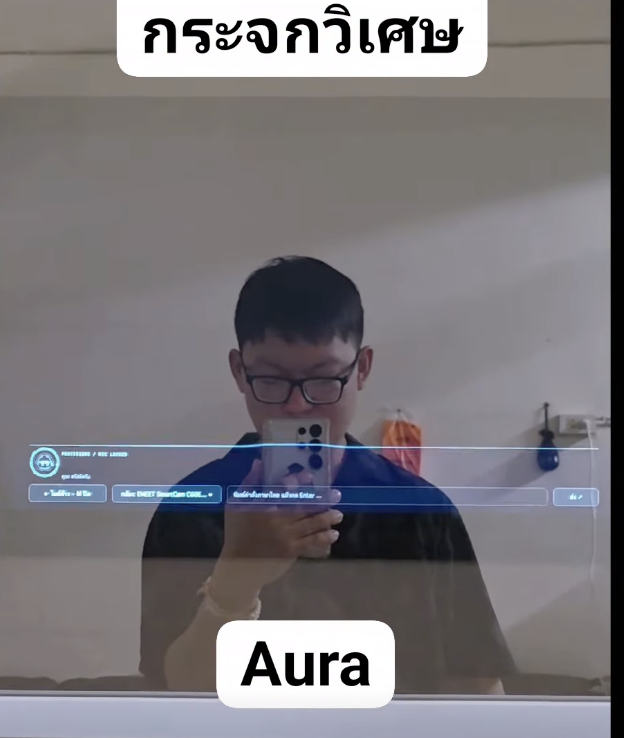
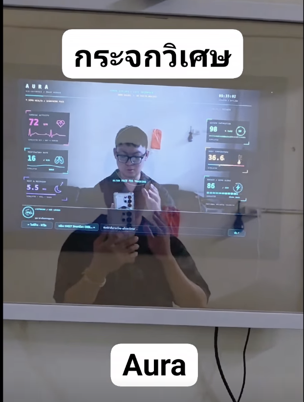

# MagicMirror / AURA

กระจก Python พร้อมผู้ช่วยเสียงภาษาไทยและอินเทอร์เฟซนีออนแบบ sci-fi
เริ่มที่หน้า standby โดย **ยังไม่เปิดกล้องและไมค์**

## ภาพกระจกใช้งานจริง

| หน้ากระจกปกติ | หน้าสุขภาพ |
|---|---|
|  |  |

## เปลี่ยนพื้นหลังและอวาตาร์ 3D แบบในเครื่อง

เข้าหน้าหลัก กด **L / AI Studio** แล้วเลือกโหมด:

- **เปลี่ยนพื้นหลัง · Offline**: แยกตัวคนจากกล้องแล้วซ้อนห้องสตูดิโอ ภูเขา อวกาศ หรือรูปที่เลือกจากเครื่อง
- **อวาตาร์ 3D · Offline**: ใช้ตัวละครการ์ตูนคนหรือหุ่นยนต์ที่สร้างด้วย Three.js ขยับตามหน้าและท่าทาง
  รองรับการหันหัว อ้าปาก กระพริบตา แขนและขา เลือกหมวกแก๊ป/มงกุฎและสีชุดได้

กด **เริ่มกล้อง · Offline** เพื่อเริ่ม และ **หยุด / กลับหน้าหลัก** เพื่อปิดกล้องและคืนตัวติดตาม
เปิด **ดูกล้องต้นฉบับ** หากต้องการเทียบภาพ (ค่าเริ่มต้นไม่แสดงภาพต้นฉบับ)
หากต้องการให้ขาของอวาตาร์ขยับตาม ต้องตั้งกล้องให้เห็นขา ส่วนที่มองไม่เห็นจะใช้ท่าพื้นฐาน
ทำงานกับคนเดียวและภาพที่มีแสงเพียงพอ หันเร็ว บังหน้า หรือฉากใกล้เคียงสีผมอาจทำให้ติดตามพลาด

สองโหมดนี้ใช้ MediaPipe/WASM ที่ bundle ในโปรเจกต์ ไม่ใช้ Decart API key ไม่ดาวน์โหลดโมเดลหนัก
และไม่ส่งเฟรมกล้องออกไปภายนอก รูปพื้นหลังที่เลือกจะอยู่ในหน่วยความจำของหน้า Studio
ไฟล์โมเดลรวมประมาณ 10 MB และรวม runtime ประมาณ 31 MB ไม่ใช่โมเดล Diffusion ขนาดหลาย GB
ระบบเสียง Gemini และการถอดเสียงเดิมยังเป็นบริการออนไลน์เมื่อผู้ใช้เปิดไมค์; ข้อความออฟไลน์หมายถึงเอฟเฟกต์ภาพสองโหมดนี้

ผลทดสอบด้วยภาพบุคคลตัวอย่างที่ส่งเป็นวิดีโอใน embedded WebEngine บน M1 Pro:
แสดงผลประมาณ 60 FPS และติดตามประมาณ 15 FPS ไม่ใช่ benchmark จากกล้องจริง
ทดสอบเปลี่ยนพื้นหลังและติดตามท่าร่างกายด้วยโมเดลจริง และทดสอบการตรวจหน้าด้วยภาพระยะใกล้
แหล่งภาพทดสอบ: https://storage.googleapis.com/mediapipe-assets/pose.jpg

## Studio / พื้นหลังและอวาตาร์ออฟไลน์

หลังเข้าหน้าหลัก กดปุ่ม **AI Studio**, กด **L**, หรือพูด **เปิดลูซี่** / **เปิดเอไอสตูดิโอ**
ค่าเริ่มต้นเป็น **เปลี่ยนพื้นหลัง · Offline** ส่วนโมเดล Inpainting รุ่นทดลองถูกนำออกจากเครื่องแล้ว
Local AI · Metal ด้านล่างเป็นฟีเจอร์ทดลองที่ต้องติดตั้งโมเดลแยกก่อนใช้งาน
หากต้องการฟิลเตอร์สดแบบเบา ให้เลือก **Local GPU** แล้วเลือกอนิเมะ ไซเบอร์พังก์ โฮโลแกรม หรือสีน้ำ และกด **เริ่ม Local**
ทำเอฟเฟกต์จากกล้องในเครื่อง ไม่ส่งภาพออก ไม่ใช้ API key ไม่ใช้เครดิต และสลับสไตล์ได้ทันที
ช่องข้อความ Local จับชื่อสไตล์ทั้งไทยและอังกฤษ ไม่ใช่ generative model ที่สร้างเสื้อผ้าหรือฉากใหม่
แสดง FPS ของภาพที่ประมวลผลจริง และคืนกล้องเมื่อกดหยุดหรือกลับหน้าหลัก

เลือก **อวาตาร์ 3D · Offline** เพื่อใช้ตัวการ์ตูนหรือหุ่นยนต์ที่ขยับตามตัวและสีหน้า
ระบบปรับเฟรมครึ่งตัว/เต็มตัวตามส่วนที่กล้องมองเห็น โดยรอให้ตำแหน่งนิ่งก่อนเปลี่ยนเฟรม
มีหัวสัตว์ 5 แบบ: แมว สุนัข กระต่าย จิ้งจอก และแพนด้า จาก [Kenney Cube Pets](https://kenney.nl/assets/cube-pets)
โมเดลและ texture เก็บในเครื่อง รวมประมาณ 700 KB ภายใต้ CC0; ใช้เป็นหัวมาสคอตบนร่างที่ติดตามท่าทาง
ติ๊ก **ใช้ใบหน้าฉัน** เพื่อวางภาพใบหน้าจริงตามขอบหน้าบนหัวตัวละคร ยกเลิกติ๊กเพื่อคืนหน้าตัวละคร
ใช้ได้กับตัวการ์ตูน หุ่นยนต์ และสัตว์ ภาพหน้าประมวลผลในเครื่อง ไม่บันทึกหรือส่งออก
เมื่อไม่พบหน้า จะซ่อนภาพหน้าจริงและใช้หน้าตัวละครชั่วคราว สิ่งที่บังใบหน้าในกล้องจะติดมาด้วย
ปรับ **ขนาดใบหน้า** ได้ 60–150% และ **ขนาดหมวก** แยกได้ 60–160%
เลือก **สีหมวก** แยกจากสีชุด หมวกแสดงเป็นชั้นนอกสุด ใบหน้าฉายลงบนผิวสามมิติของหัวโมเดล จึงติดกับผิวหัวเมื่อหันข้าง
ปุ่ม **ตามกล้อง / เต็มตัว / ครึ่งตัว** เลือกการจัดเฟรมได้ โดยตามกล้องจะตรวจส่วนร่างกายที่มองเห็น
ภาพใช้พื้นที่เต็มหน้าต่าง เมนูเป็นแผงด้านล่าง กด **พับเมนูลง** หรือ **F2** เพื่อพับลง เหลือแถบเปิดกลับขึ้นมา

หากต้องการสร้างภาพตาม prompt แบบ Lucy ให้เลือก **Lucy 2.5 Cloud**:

1. กด **ตั้ง Decart API key** และใส่คีย์จาก https://platform.decart.ai/api-keys
   คีย์เก็บเฉพาะเครื่องที่ `.secrets/decart-api-key` (ไม่ขึ้น GitHub)
   หรือใช้ environment variable `DECART_API_KEY` ก่อนเปิดแอป
2. กด **ดูกล้องในเครื่อง** เพื่อตรวจกล้องได้โดยไม่ส่งภาพและไม่ใช้คีย์
3. กด **เริ่ม AI · ส่งภาพไป Decart** เพื่อเริ่ม WebRTC; ใช้อินเทอร์เน็ตและเครดิต Decart
4. เปลี่ยน preset หรือพิมพ์ prompt แล้วกดเปลี่ยนเอฟเฟกต์ได้ระหว่างใช้งาน
5. กด **หยุด** หรือ **กลับหน้าหลัก** เพื่อคืนกล้อง; AI หยุดอัตโนมัติหลัง 2 นาที

ส่งเฉพาะวิดีโอ ไม่ส่งไมโครโฟน คีย์ Gemini เดิมใช้แทน Decart ไม่ได้
เลือกเว็บแคมสำหรับ Studio จากรายการภายในหน้า Studio ได้แยกจากกล้องปกติ
หากหน้าสุขภาพไม่แสดงระหว่างอยู่ Studio ให้กลับหน้าหลักแล้วสั่งตรวจสุขภาพตามปกติ
เฉพาะ Cloud ใช้บริการโมเดลจริง; ยังไม่ได้ทดสอบภาพที่โมเดลสร้างเพราะยังไม่มี Decart key
Local ทดสอบใน WebEngine ด้วยวิดีโอจำลอง 640×360 ได้ประมาณ 30 FPS ไม่ใช่ผลวัดจากกล้องจริง
รายละเอียดหลักการ หลักฐาน REA และข้อจำกัดอยู่ใน [รายงาน](docs/LUCY_ANALYSIS.md)

Frontend ที่ bundle มาแล้วเปิดได้เลยโดยไม่ต้องติดตั้ง Node เพิ่ม หากแก้ JavaScript ให้ rebuild:

```sh
npm ci --prefix web/lucy
npm run --prefix web/lucy build
node --test web/lucy/test-session.mjs
```

## ดาวน์โหลดจาก GitHub

```sh
git clone https://github.com/cryptoclocks/MagicMirror.git
cd MagicMirror
/bin/zsh "./Start SmartMirror.command"
```

ติดตั้ง Python 3 ก่อนใช้งาน
API key ให้ตั้งในเครื่องตามหัวข้อเสียงด้านล่าง; ไม่รวมอยู่ใน repository

## เปิดใช้งาน (macOS)

ดับเบิลคลิก `Start SmartMirror.command` หรือวางคำสั่งนี้ใน Terminal:

```sh
/bin/zsh "/Users/cryptoclock/Desktop/SmartMirror/Start SmartMirror.command"
```

ตัวเปิดจะติดตั้ง dependencies ที่ขาดลง `.venv` ภายในโปรเจกต์ ใช้ `opencv-contrib-python` สำหรับ facial landmarks
และเตรียมโมเดล LBF ขนาดประมาณ 54 MB (ดาวน์โหลดเมื่อยังไม่มี พร้อมตรวจ SHA-256) ไม่ใช้ `opencv-python` ควบคู่กัน
หากติดตั้งด้วยตนเอง ให้รัน `.venv/bin/python tools/setup_landmarks.py` หลังติดตั้ง requirements
ห้ามวางเนื้อหาภายในไฟล์ `.command` ลง Terminal โดยตรง

1. กด **M** หรือคลิกปุ่มเปิดไมค์ แล้วรอเอฟเฟกต์ก่อนพูด **เข้าหน้าหลัก**
2. อนุญาต Microphone และ Camera ให้แอปที่เปิดโปรแกรม เช่น Terminal หรือ Codex ใน System Settings → Privacy & Security
3. ออร่าทักทายด้วยเสียงไทย เปิดกล้อง และแสดงกระจกปกติ ไม่มีกราฟสุขภาพ
4. กด M สั้นเพื่อฟังหนึ่งคำสั่ง หรือกด M ค้างครึ่งวินาทีเพื่อล็อกฟังต่อเนื่อง หรือใช้ช่องพิมพ์แล้วกด Enter

โหมดครั้งเดียวรอฟังประมาณ 9 วินาที หยุดหลังพูดจบและเงียบประมาณ 1.15 วินาที
**กด M ค้างอย่างน้อย 0.5 วินาที** แล้วปล่อย จะล็อกไมค์ไว้ มีป้าย MIC LOCKED และปุ่ม “ไมค์ค้าง · M ปิด”
รอฟังได้ต่อเนื่องโดยไม่ตัดตอนเงียบ และฟังคำสั่งถัดไปโดยอัตโนมัติหลังตอบจบ
ระหว่างออร่าพูดจะพักรับเสียง เพื่อไม่ให้รับเสียงตัวเองเป็นคำสั่ง แล้วเปิดฟังต่อเมื่อเสียงจบ
**กด M อีกครั้ง** หรือกดปุ่มไมค์เพื่อปิดล็อก ไม่ต้องกดค้างตลอดเวลา
เสียงเงียบขณะรอฟังเก็บแค่บัฟเฟอร์สั้น ๆ; ไม่สะสมเสียงทั้งหมดในหน่วยความจำ
ขณะกำลังถอดเสียงอาจต้องรอเครือข่ายจบคำขอก่อนเปิดรอบใหม่

## 5 ประโยคหลัก / 10 คำตอบ

แต่ละคำสั่งมีคำตอบสลับกัน 2 แบบ รวม 10 คำตอบ อยู่ใน `assistant_logic.py`
เป็นบทสนทนาเตรียมไว้ ไม่ต้องใช้ LLM หรือ API key

| พูด | ผลลัพธ์ |
|---|---|
| **เข้าหน้าหลัก** | เริ่มระบบ ทักทาย เปิดกล้อง ไม่มีเส้นสุขภาพ |
| **เช็คยอดขายนาฬิกาคริปโต** | เปลี่ยนเป็นหน้าขาย หมุนโมเดลนาฬิกาจากกลางไปซ้าย กราฟแท่งคู่และยอดเงินจำลอง |
| **กลับหน้าหลัก** | กลับกล้องปกติและปิดกราฟสุขภาพ |
| **ตรวจสุขภาพ** | เปิด HUD ชีพจร ECG ออกซิเจน การหายใจ อุณหภูมิ และมาร์คเกอร์ใบหน้า |
| **รายงานสุขภาพ** | พูดบทสรุปสุขภาพเดโมเรื่องพักผ่อนน้อย พร้อมคำแนะนำนอนอย่างน้อย 7 ชั่วโมงและจิบน้ำระหว่างวัน |
| **ขอส่องกระจก** | ปิดกล้องและทำหน้าจอดำ เพื่อใช้กับกระจกจริง |

รองรับ “ตรวจสอขภาพ” ตามข้อความเดิม และ “เช็กยอดขาย”, “ดูยอดขาย”, คำลงท้าย “ครับ/ค่ะ” เป็นต้น
จับคำสั่งด้วยคีย์เวิร์ดและเจตนา รองรับประโยคยาว เช่น “ช่วยดูยอดขายวันนี้ให้หน่อย”, “เช็คสุขภาพให้หน่อย”, “เปิดหน้าแรก”
แก้รูปคำที่ถอดเสียงคลาดเคลื่อน และเทียบข้อความใกล้เคียงแบบมีเกณฑ์ความมั่นใจเมื่อไม่พบคีย์เวิร์ด
ลองใช้คำถอดเสียงทางเลือกจากบริการเมื่อผลแรกจับคำสั่งไม่ได้
หากเจอคำปฏิเสธ เช่น “ไม่ต้องตรวจสุขภาพ” จะไม่เปลี่ยนหน้า; หากเจอหลายเจตนาจะขอให้พูดทีละคำสั่ง
คำสั่งไม่ตรงจะเงียบ โดยไม่เปลี่ยนหน้า
ตอน standby ต้องเริ่มด้วย “เข้าหน้าหลัก”; โหมดดำกลับมาได้ด้วย “เข้าหน้าหลัก” หรือ “กลับหน้าหลัก”

โหมดดำจะซ่อน UI ทั้งหมดหลังพูดตอบจบ เลื่อนเมาส์ลงด้านล่างจอเพื่อเรียกปุ่มและช่องพิมพ์
หรือกด M เพื่อเปิดไมค์อีกครั้ง จอดำไม่ใช่การปิดเครื่องหรือปิดแอป

## เสียงสรุปยอดขายและสุขภาพ

“เช็คยอดขายนาฬิกาคริปโต” จะอ่านยอดตรง ๆ ไม่เกริ่นเรื่องโฮโลแกรมหรือยอดตัวอย่าง:
**วันนี้ 45,150 บาท · เดือนนี้ 516,000 บาท · ปีนี้ 4,644,000 บาท**
คำนวณข้อความจากข้อมูลเดียวกับการ์ดบนหน้า sales โดยใช้แท่งล่าสุดของแต่ละกราฟ
ป้าย DEMO DATA ยังคงแสดงบนหน้าจอ; ไม่มีการเชื่อมต่อยอดขายจริง

“รายงานสุขภาพ” หรือ “ช่วยสรุปสุขภาพให้หน่อย” จะเปิดหน้า health และพูดบทสรุปเดโม
เช่น “อดนอนมากไปหน่อย” พร้อมแนะนำให้นอนอย่างน้อยเจ็ดชั่วโมงและจิบน้ำระหว่างวัน
บทสรุปนี้เตรียมไว้ล่วงหน้า ไม่ได้คำนวณการอดนอนจากภาพใบหน้า

## สิ่งที่ต้องทำวันนี้

พูด **ขอสิ่งที่ต้องทำวันนี้**, **วันนี้ต้องทำอะไร** หรือ **งานวันนี้**
ออร่าจะอ่านรายการที่ยังไม่เสร็จ และเปิดตารางงานพร้อมเวลาและวงความคืบหน้า
กดแถวงานเพื่อสลับเสร็จ/ยังไม่เสร็จ ความคืบหน้าแยกตามวันในเขตเวลา Asia/Bangkok

เริ่มจากรายการเดโม 5 งานเกี่ยวกับออเดอร์ จัดส่ง โปรโมต ติดตามลูกค้า และสรุปยอดขาย
**ยังไม่ใช่รายการจากปฏิทินหรือบัญชีงานจริง** แก้เวลาและชื่องานได้ที่ `daily_tasks.json`
ถ้าเปลี่ยนเป็นงานของตัวเอง ให้ตั้ง `is_demo` เป็น `false`
สถานะงานอยู่ที่ `.local/tasks-state.json` เป็นข้อมูลใช้งานที่ตั้งใจเก็บไว้ ไม่ใช่ไฟล์ขยะ

## ลองหมวก AR

หลังเข้าหน้าหลัก กด M แล้วพูด **เลือกหมวก** หรือกด **B** เพื่อเปิดแถบหมวก 5 แบบ:
หมวกแก๊ป, หมวกทรงสูง, หมวกปีกกว้าง, หมวกรับปริญญา และมงกุฎ

- กดรูปเพื่อเลือก หรือพูด **หมวกเบอร์หนึ่ง** ถึง **หมวกเบอร์ห้า** / **ใส่หมวกแก๊ป** / **ใส่มงกุฎ**
- กด **1–5** เพื่อเลือกอย่างรวดเร็วขณะเปิดแถบหมวก
- พูด **เอาหมวกออก** หรือ **ถอดหมวก** หรือกดปุ่มเอาหมวกออก เพื่อปิดเอฟเฟกต์และซ่อนแถบ
- กด **↑ / ↓** หรือปุ่มสูงขึ้น/ต่ำลงเพื่อปรับระดับ และ **[ / ]** เพื่อปรับขนาดให้เข้ากับทรงผม
- ใช้แนวตา กราม และคางจาก OpenCV landmarks เพื่อตามตำแหน่ง ขนาด และความเอียงศีรษะ
- ถ้าจับ landmarks ไม่ได้หรือภาพกล้องค้าง จะซ่อนหมวกทันที ไม่ใช้กรอบหน้าเดาตำแหน่งแทน
- เป็นภาพแบนสองมิติที่หมุนตามการเอียงศีรษะ ไม่ใช่โมเดล 3D หรือการแยกเส้นผม
- โหมดขายและจอดำจะไม่แสดงหมวก; การสั่งเอาหมวกออกไม่เปลี่ยนโหมดสุขภาพที่เปิดอยู่

หมวกเป็นภาพ PNG สมจริงที่สร้างด้วย imagegen แบบ built-in พื้นหลังโปร่งใส 5 แบบ
เก็บไฟล์และพรอมป์ต์ที่ใช้จริงใน `assets/hats/GENERATION.json` ไม่ใช้ภาพการ์ตูนเดิม
รักษาสัดส่วนภาพจริงและปรับจุดยึดลงมาแนบหน้าผากมากขึ้น ยังปรับ ↑↓ และ [ ] ตามทรงผมได้
เป็นภาพซ้อนแบบ 2D ไม่ใช่การจำลองโมเดลหมวกสามมิติหรือการแยกเส้นผม

## สลับกล้อง / เว็บแคม

กดปุ่ม **กล้อง: … ▾** ด้านล่างจอ แล้วเลือกชื่อเว็บแคมที่เสียบอยู่ หรือกด **V** เพื่อเปิดรายการ
สลับกลับกล้อง MacBook ได้จากเมนูเดียวกัน รองรับการรีเฟรชและอัปเดตรายการเมื่อเสียบ/ถอดกล้อง

ถ้าอยู่หน้าหลักหรือสุขภาพ จะต่อกล้องที่เลือกทันที ถ้าอยู่ standby, หน้าขาย หรือจอดำ
จะจำตัวเลือกไว้และยังไม่เปิดกล้องจนกลับหน้าหลัก ในโหมด demo การเลือกกล้องจะเปลี่ยนเป็นภาพจริง
ถ้าพบกล้องเดียว ให้เสียบเว็บแคมแล้วเปิดรายการใหม่

## หน้าสุขภาพและอินโฟกราฟิก

พูด “ตรวจสุขภาพ” หรือ “รายงานสุขภาพ” แล้วแสดงค่าจำลองทันที ไม่ต้องรอการจับหน้าหรือสแกนครบเวลา
การติดตามใบหน้าเป็นส่วนแยก: เมื่อไม่พบหน้า ตัวเลขยังแสดง แต่จุดและเส้นติดตามจะไม่วาดแทนขึ้นมา
แถบเลือกหมวกจะซ่อนเมื่อเข้าหน้าสุขภาพ เพื่อไม่ให้บังข้อมูล

| ข้อมูลจำลอง | ภาพเคลื่อนไหว |
|---|---|
| ชีพจร 72 BPM | หัวใจ line art เต้นและเส้น ECG วิ่ง |
| การหายใจ 16 ครั้ง/นาที | ปอดขยาย–หด พร้อมจังหวะหายใจเข้า–ออก |
| ออกซิเจน 98% | วงระดับออกซิเจนและฟองโมเลกุลหมุน |
| อุณหภูมิ 36.6 °C | เทอร์โมมิเตอร์มีระดับปรอทและสเกลไล่สี |
| พลังงาน 86/100 | สายฟ้า วงชาร์จหมุน และช่องแบตเตอรี่ |
| การพักผ่อน 5.5 ชั่วโมง | พระจันทร์กับ z เคลื่อน และแถบเป้าหมาย 7 ชั่วโมง |

## เอฟเฟกต์และกราฟ

- แกนผู้ช่วยเสียงมีวงแหวนหมุนและคลื่นแสง เปลี่ยนสถานะ READY / LISTENING / PROCESSING / SPEAKING
- ขณะฟัง คลื่นตอบสนองระดับเสียงไมค์จริง; ขณะ Gemini พูดตอบ คลื่นตอบสนองเสียงที่เล่นจริง
- เสียงตอบกลับหลักใช้ **Gemini Live API / Leda** ผู้หญิงไทยเสียงสดใส น่ารัก พูดกระชับและเร็วขึ้น พร้อมคำลงท้ายค่ะ/คะ
- ตั้งค่าโทนและรุ่นโมเดลใน `voice_settings.json`; หาก Gemini เชื่อมต่อไม่ได้จะใช้เสียงผู้หญิง Kanya ในเครื่องที่ 225 คำ/นาที
- เอฟเฟกต์ขณะ Gemini พูดขยับตาม RMS ของ PCM ที่เล่นจริง มีเสียง UI สังเคราะห์สั้น ๆ ประกอบ
- โมเดลนาฬิกาเรนเดอร์จาก `Technical-Speaker-First.blend` ใน Production ที่ผู้ใช้ให้มา โดยไม่แก้หรือเซฟทับต้นฉบับ
- กราฟแท่งคู่สี cyan / violet แสดงช่วงปัจจุบันเทียบช่วงเปรียบเทียบ การ์ดวันนี้/เดือนนี้/ปีนี้ตรงกับแท่งล่าสุดของแต่ละกราฟ
- สลับรายวัน (7 วัน), รายเดือน (6 เดือน), รายปี (5 ปี) ด้วยแท็บหรือปุ่ม 1/2/3
- รายปี: แต่ละปีเทียบปีก่อนหน้า; รายวันและรายเดือน: เทียบช่วงก่อนหน้าที่มีความยาวเท่ากัน
- หน้า health เท่านั้นที่มีเส้นกราฟิกติดตามใบหน้า และตาข่ายนีออนปรากฏ 2 วินาทีทุก 5 วินาที พร้อมเฟดเข้า–ออก

ตรวจความสอดคล้องของค่าตัวอย่างและแหล่งอ้างอิงไว้ใน [HEALTH_DEMO.md](HEALTH_DEMO.md)
ค่าชีพจร/หายใจ/ออกซิเจน/อุณหภูมิอยู่ในช่วงทั่วไปของผู้ใหญ่ขณะพัก แต่การนอน 5.5 ชั่วโมงต่ำกว่าเป้า 7 ชั่วโมงตามบทเดโม
ค่า Energy เป็นคะแนนกราฟิกสมมติ ไม่มีเกณฑ์แพทย์รองรับ และโปรแกรมไม่สามารถบอกได้ว่าผู้ใช้สุขภาพปกติจากกล้อง

**ยอดขายและค่าสุขภาพทั้งหมดเป็นข้อมูลจำลอง** ไม่มีการเชื่อมต่อยอดขายจริงหรือวิเคราะห์สุขภาพจากใบหน้า
ภาพกล้องจริงใช้ OpenCV Facemark LBF ตรวจจับ 68 จุดบนกราม คิ้ว ตา จมูก และริมฝีปาก
พร้อม optical flow ระหว่างเฟรม จุดอ้างอิงพิกัดภาพจริงและผ่านการแปลงครอปแบบเดียวกับภาพกล้อง
ไม่มีจุดหน้าผากที่เดาขึ้นจากกรอบหน้า และไม่วาดตาข่ายแทนเมื่อจับ landmarks ไม่สำเร็จ
โหมด mannequin demo เท่านั้นที่ใช้ตาข่ายวาดขึ้นเพื่อสาธิต
ควรหันหน้าค่อนข้างตรงและมีแสงเพียงพอ; การหันมาก การบังหน้า และแสงน้อยอาจทำให้จุดคลาดเคลื่อนหรือหายไป

## ปุ่มควบคุม

| ปุ่ม | การทำงาน |
|---|---|
| M สั้น / Space | เปิดไมค์หนึ่งคำสั่ง / ยกเลิกการฟัง |
| M ค้าง ≥ 0.5 วินาที | ล็อกฟังต่อเนื่อง; ปล่อยได้ แล้วกด M อีกครั้งเพื่อปิด |
| H | โฟกัสช่องพิมพ์คำสั่ง |
| V | เปิดรายการเลือกกล้อง / เว็บแคม |
| B | เปิดแถบลองหมวก |
| ↑ / ↓, [ / ] | ปรับระดับและขนาดหมวกขณะเปิดแถบ |
| 1 / 2 / 3 | รายวัน / รายเดือน / รายปี ในหน้าขาย |
| F | สลับเต็มจอ |
| Esc | ออกจากเต็มจอ / ปิดเมื่ออยู่หน้าต่าง |
| Q | ปิดโปรแกรม คืนกล้องและไมค์ |
| D | สลับแหล่งภาพจริงกับ mannequin demo โดยไม่เริ่มกล้องใน standby |
| R | เชื่อมต่อกล้องใหม่ในหน้าหลักหรือ health |
| C | เปิดหน้าสิทธิ์กล้องของ macOS |
| I | เปิดหน้าสิทธิ์ไมค์ของ macOS |
| − / + | ลด / เพิ่มความทึบ HUD สุขภาพ |

หากกำลังพิมพ์ในช่องข้อความ ปุ่มตัวอักษรจะเป็นการพิมพ์ตามปกติ ให้คลิกพื้นหลังเพื่อใช้คีย์ลัด

## เสียงและความเป็นส่วนตัว

ภาพกล้องประมวลผลในเครื่อง ไม่บันทึกหรือส่งออก
**การถอดเสียงภาษาไทยต้องมีอินเทอร์เน็ต และส่งเสียงไปยัง Google Speech ผ่าน HTTPS เฉพาะเมื่อเปิดไมค์ ทั้งโหมดครั้งเดียวและโหมดล็อกฟังต่อเนื่อง**
เสียงอยู่ในหน่วยความจำระหว่างทำคำสั่ง ไม่มีการเซฟเสียงผู้ใช้ลงดิสก์
บริการนี้ใช้สำหรับเดโม หากถอดเสียงไม่ได้ ใช้ช่องพิมพ์แทนได้ทุกคำสั่ง
**ข้อความตอบกลับถูกส่งไปยัง Gemini Live API เพื่อสร้างเสียง** ไม่มีการส่งภาพกล้องให้ Gemini
ส่งข้อความผ่าน WebSocket ที่เข้ารหัสและส่ง API key ทาง header ไม่ใส่ใน URL หรือ log
API key อ่านจาก environment `GEMINI_API_KEY` หรือ `.secrets/gemini-api-key` ซึ่งแยกจากโค้ดและถูก gitignore (ไฟล์สิทธิ์ 600)
ไม่มีการฝัง API key ลงในโค้ดหรือไฟล์ตั้งค่าเสียงที่แชร์ได้
เสียงตอบกลับสตรีมเข้าเครื่องในหน่วยความจำ ไม่เซฟบทสนทนาหรือเสียงผู้ใช้
ดู [Gemini Live API](https://ai.google.dev/gemini-api/docs/live-api/capabilities) สำหรับการตั้งค่าเสียง
`assets/voice-preview.wav` เป็นคลิปคำทักทายสังเคราะห์ที่ตั้งใจเก็บไว้ให้ทดลองฟัง ไม่ใช่เสียงผู้ใช้

หากเสียงตอบกลับไม่มี ให้ตรวจอินเทอร์เน็ต ระดับเสียงเครื่อง และสิทธิ์ใช้งาน Gemini API; เสียง Kanya ในเครื่องเป็นตัวสำรอง
หากไมค์เงียบ ให้ตรวจสิทธิ์ Microphone และเลือกไมค์ปริยายของ macOS ให้ถูกต้อง

## เดโม / ตรวจงาน

```sh
.venv/bin/python smartmirror.py --demo
.venv/bin/python smartmirror.py --fullscreen
.venv/bin/python smartmirror.py --demo --mute
.venv/bin/python smartmirror.py --camera 1
QT_QPA_PLATFORM=offscreen .venv/bin/python smartmirror.py --preview preview-start.png
QT_QPA_PLATFORM=offscreen .venv/bin/python smartmirror.py --page sales --preview preview-sales.png
QT_QPA_PLATFORM=offscreen .venv/bin/python smartmirror.py --page health --preview preview.png
PYTHONDONTWRITEBYTECODE=1 .venv/bin/python -m unittest discover -s tests
```

`--page` ใช้เลือกหน้าในการสาธิตหรือเรนเดอร์ preview; การเปิดปกติเริ่ม standby เสมอ
เดโมใช้ mannequin วาดขึ้นเอง ไม่มีภาพคนจากไฟล์ตัวอย่าง
เป้าหมายหลักคือ macOS; Gemini เล่นเสียงผ่าน sounddevice ได้ข้ามแพลตฟอร์ม ส่วนเสียงสำรอง `say` มีเฉพาะ macOS

ไฟล์ใน `assets/` และ `.venv` จำเป็นต่อการใช้งาน ไฟล์ preview เป็นภาพตัวอย่างที่ตั้งใจเก็บไว้
ไม่มีไฟล์อัดเสียงผู้ใช้ ไฟล์ render ชั่วคราว หรือการดาวน์โหลด EffectCraft

Automatic camera retouch uses OpenCV landmarks for subtle cheek slimming, eyebrow darkening and skin brightening/smoothing, without an on-screen indicator. Eyes and lips retain detail. Overlay landmarks follow the adjusted face; detection uses original camera pixels. Tracking uses robust optical flow and refits the moving face ROI across brief detector misses. Lost tracking fades out within 160 ms; held points are never sent to HUD/hat overlays. Camera changes clear retouch state. Unmatched commands are silent.

## Local AI บน M1 Pro 16 GB — สร้างหมวก/ชุด/หน้า/ฉากใหม่

โหมดทดลอง **Local AI · Metal** ใช้ Stable Diffusion 1.5
Inpainting + LCM-LoRA สร้างรายละเอียดใหม่จริงในพื้นที่ที่เลือก แยกจาก Local GPU ซึ่งเป็นฟิลเตอร์ภาพ
ไม่ต้องใช้ Decart API key และไม่ส่งภาพหรือ prompt ออกไปขณะสร้าง

โมเดลรุ่นนี้ถูกนำออกจากเครื่องแล้วตามคำขอ หากต้องการติดตั้งกลับ ให้เปิด `Install Local AI.command`
ตัวติดตั้งใช้ `.venv-ai` แยกจากโปรแกรมหลัก และดาวน์โหลดโมเดล/adapter ที่ตรึงรุ่นไว้ประมาณ 3 GB
เก็บใน `.local-ai/` ซึ่งไม่ขึ้น GitHub ดาวน์โหลดครั้งแรกใช้อินเทอร์เน็ต หลังจากนั้น worker บังคับใช้ไฟล์ในเครื่อง
แหล่งโมเดลและเงื่อนไขการใช้งาน: [SD 1.5 Inpainting](https://huggingface.co/stable-diffusion-v1-5/stable-diffusion-inpainting)
และ [LCM-LoRA SD 1.5](https://huggingface.co/latent-consistency/lcm-lora-sdv1-5)

วิธีใช้:

1. เข้าหน้าหลัก กด L แล้วเลือก **Local AI · Metal** และ **เปิดกล้อง Local AI**
2. เลือก **หมวก / เสื้อผ้า / ใบหน้า / ฉากหลัง** พื้นที่สีเขียวเป็นเพียงข้อเสนอจากตำแหน่งใบหน้า
3. ระบายหรือลบพื้นที่บนภาพให้ตรงกับส่วนที่ต้องการเปลี่ยน โดยเฉพาะเมื่อไม่พบหน้า
4. ใช้ prompt ภาษาอังกฤษที่เตรียมไว้หรือแก้เอง แล้วกด **สร้างภาพ**
5. เลือก **สร้างต่อเนื่อง + ภาพหน่วง** ก่อนสร้าง เพื่อใช้บัฟเฟอร์ภาพและการชดเชยการเคลื่อนไหว
6. กด **หยุด** หรือกลับหน้าหลักเพื่อยกเลิกงาน ปิดกล้อง และคืนแรมของโมเดล

ผลวัดจริงบน M1 Pro 16 GB: 512×512, LCM 4 ขั้น ใช้ **14.05 วินาทีสำหรับสร้างภาพ**
รอบแรกที่รวมโหลดโมเดลใช้ประมาณ **36.46 วินาที** ผลขึ้นอยู่กับแรมที่เหลือและแอปอื่น
ตรวจภาพเพิ่มหมวกแล้ว และตรวจว่าพิกเซลนอกพื้นที่ที่เลือกยังตรงกับต้นฉบับ

ภาพต่อเนื่องเป็น **AI keyframes + optical flow** ไม่ใช่โมเดลสร้างวิดีโอทุกเฟรมแบบ Lucy
ระบบเก็บไม่เกิน 128 เฟรมต่อชุด เล่นการเคลื่อนไหวเป้าหมาย 8 FPS และเก็บชุดรอเล่นไม่เกินหนึ่งชุด
ความหน่วงเริ่มจากเวลาสร้างภาพ ส่วนการเปลี่ยนภาพนิ่งใช้ crossfade 650 ms
อาจเห็นภาพบิดเมื่อเคลื่อนเร็ว หันมาก หรือมีสิ่งบัง และรายละเอียดอาจเปลี่ยนระหว่าง keyframe
ภาพส่วนที่ไม่ได้เลือกจะใช้ภาพกล้องเดิม แต่การรักษาใบหน้าในพื้นที่ที่สั่งเปลี่ยนยังไม่รับประกัน

`preview-local-ai.png` เป็นภาพทดสอบ UI ด้วยวิดีโอสังเคราะห์และผลโมเดลจำลอง ไม่ใช่ตัวอย่างคุณภาพภาพที่ AI สร้าง
